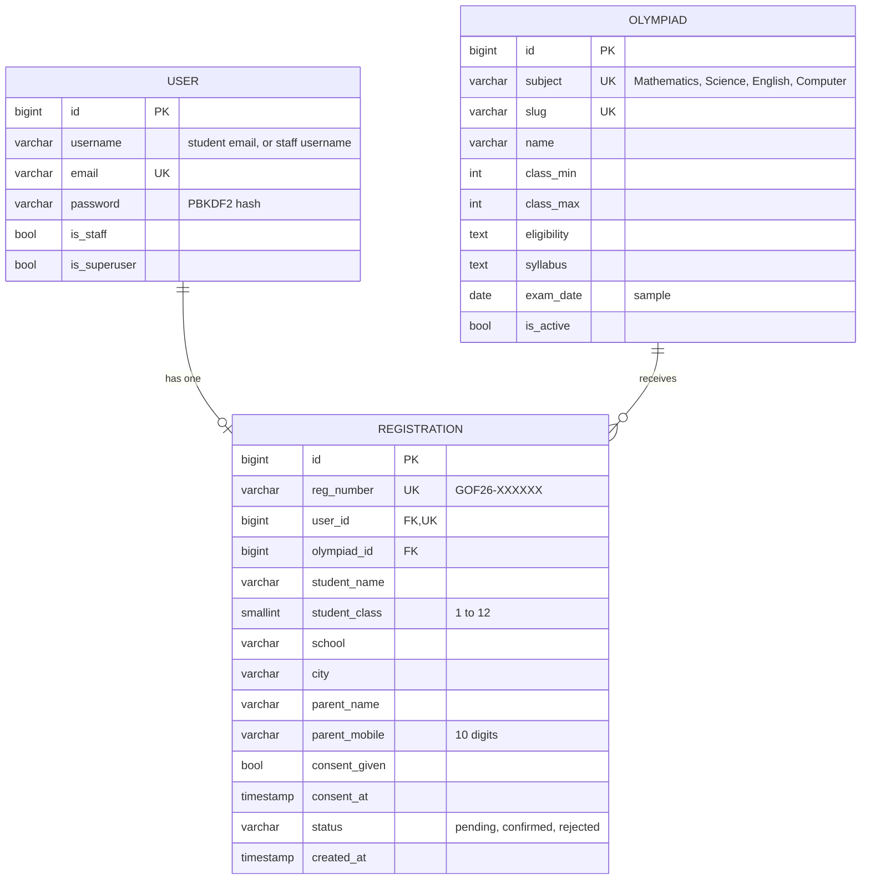

# Database schema

Relational database: PostgreSQL on staging (SQLite for local development). Managed through Django migrations.

## Duplicate protection

| Layer | Rule |
|---|---|
| Browser | Submit button locks after the first click (`data-once`). |
| Form / API | Checks email, class range and "same student + parent mobile + Olympiad" before saving. |
| Database | `UNIQUE(email)`, `UNIQUE(user_id)`, `UNIQUE(reg_number)` and `UNIQUE(lower(student_name), parent_mobile, olympiad_id)`. A double submit that slips past the checks fails safely and shows a friendly message. |

## Design notes

- A student account and its registration are created in one transaction, so there are no orphan accounts.
- `reg_number` uses an alphabet without 0/O/1/I and is retried on the rare collision.
- One registration per student account keeps the prototype simple (see known limitations).
